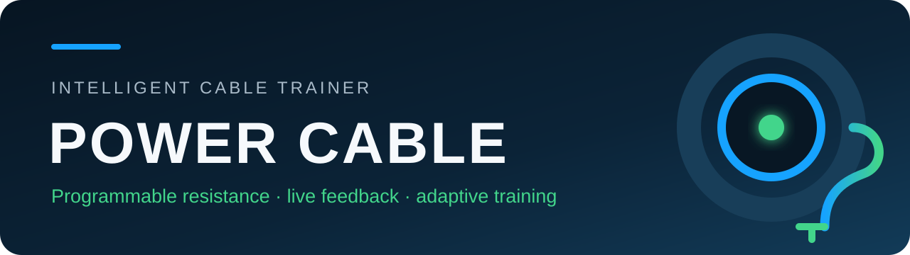
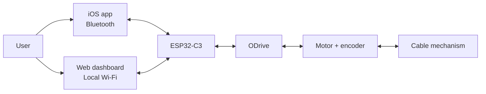
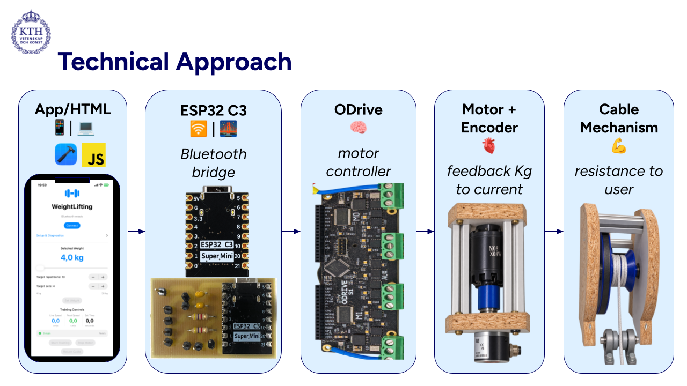
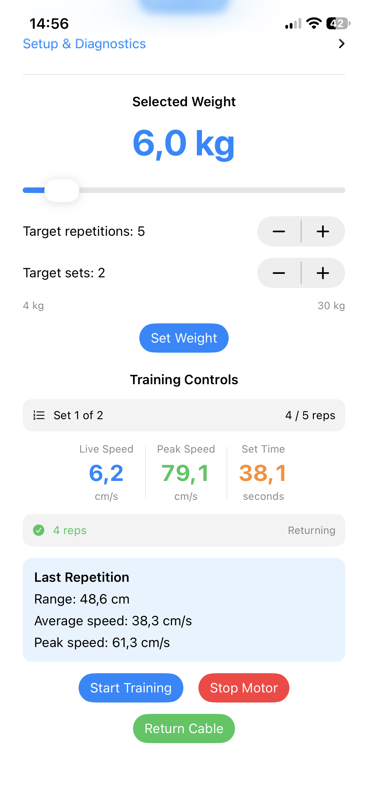
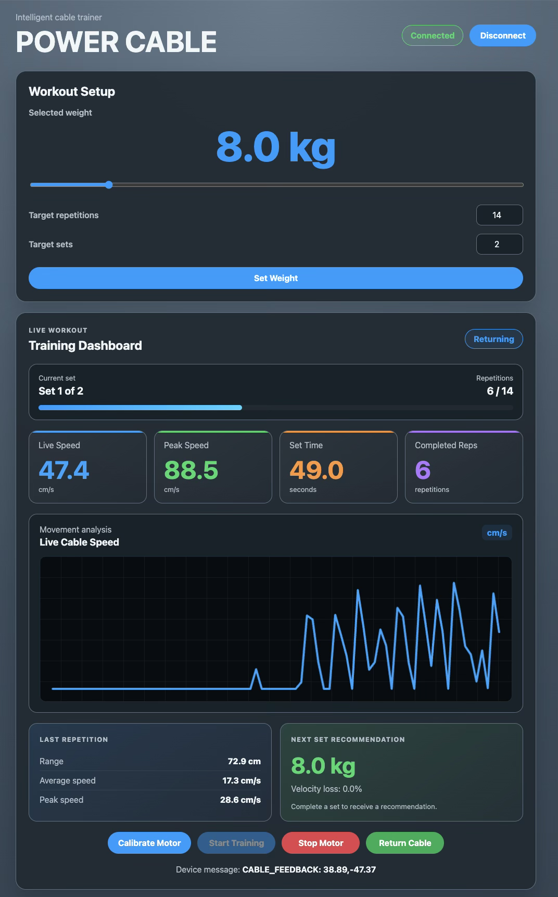

<p align="center">
  
</p>

<p align="center">
  A research prototype that creates programmable cable resistance and provides live workout feedback through an iOS app or a local Wi-Fi dashboard.
</p>

<p align="center">
  
  
  
  
</p>

<p align="center">
  <a href="#my-contribution">My contribution</a> ·
  <a href="#the-problem">The problem</a> ·
  <a href="#how-it-works">How it works</a> ·
  <a href="#user-interfaces">Interfaces</a> ·
  <a href="#prototype-in-action">Demo</a> ·
  <a href="#repository-guide">Repository</a> ·
  <a href="#getting-started">Get started</a>
</p>

<p align="center">
  
</p>

<a id="my-contribution"></a>
## 👨‍💻 My contribution

POWER CABLE V2 was developed as a group project at KTH Royal Institute of Technology. My main responsibility was turning the physical prototype into a connected training system with practical user interfaces.

I contributed:

- A native **SwiftUI iPhone application** communicating with the ESP32-C3 over Bluetooth Low Energy
- A browser-based **training dashboard** served directly by the ESP32 over its local Wi-Fi network
- Interface controls for calibration, workout configuration, training, emergency motor stop and cable return
- Live visualization of repetitions, set progress, set time, cable speed and repetition measurements
- Audio and spoken workout feedback in the iOS application
- Next-set recommendations based on velocity loss
- Firmware integration, communication testing and debugging across the ESP32, ODrive, iOS app and web dashboard

The complete group repository, including the other team members' hardware, adaptive-resistance and validation work, is available at [amsimer/Weightlifting-project](https://github.com/amsimer/Weightlifting-project).

<a id="the-problem"></a>
## 🎯 The problem

Traditional cable machines depend on large weight stacks. They take up space, limit portability and provide little information about movement quality. POWER CABLE explores a compact alternative in which a motor produces controllable resistance while an encoder measures cable movement.

The V2 prototype adds digital workout control, repetition tracking, cable-speed feedback and an adaptive recommendation for the following set.

<a id="how-it-works"></a>
## ⚙️ How it works



<p align="center">
  
</p>

<p align="center"><em>The complete control path shown with the main components used in the prototype.</em></p>

1. The user calibrates the system and selects the weight, repetitions and sets.
2. The ESP32-C3 translates the workout commands into ODrive motor-control commands.
3. The motor resists the cable movement while the encoder measures position and velocity.
4. The interface displays repetitions, set time, cable speed and workout status.
5. After a set, velocity loss can be used to recommend the next-set weight.

### Main components

| Component | Role |
|---|---|
| ESP32-C3 | Coordinates the prototype and communicates with the user interfaces |
| ODrive | Controls motor current, velocity and position |
| Motor and encoder | Produce resistance and measure cable movement |
| Cable mechanism | Transfers motor resistance to the training handle |
| iOS application | Portable Bluetooth workout control and audio feedback |
| Web dashboard | Browser-based control and live visualization over local Wi-Fi |

<a id="user-interfaces"></a>
## 📱 User interfaces

<details open>
<summary><strong>iOS application — Bluetooth Low Energy</strong></summary>

The SwiftUI application connects directly to the ESP32-C3. It supports motor calibration, workout configuration, start/stop control, cable return, live repetition tracking, set timing, cable-speed feedback and spoken/audio feedback.

Source: [`V2/iOS-APP`](V2/iOS-APP)

</details>

<details>
<summary><strong>Web dashboard — local Wi-Fi</strong></summary>

The browser interface is designed to run from the ESP32 itself. The user joins the local `POWER-CABLE` Wi-Fi network and opens the dashboard without requiring an internet connection or app installation. It provides workout controls, live measurements, a speed graph and next-set feedback.

Source: [`V2/Web`](V2/Web)

</details>

<details>
<summary><strong>Firmware and safety controls</strong></summary>

The ESP32 firmware manages BLE commands, ODrive communication, calibration checks, training state, cable feedback and safe return-to-start behavior. Training is blocked until the required calibration and start-position checks pass.

Source: [`V2/Firmware`](V2/Firmware)

</details>

<a id="prototype-in-action"></a>
## 🎥 Prototype in action

The interfaces below were recorded during real training sessions. Select either screenshot to open the corresponding screen recording.

<p align="center">
  <a href="docs/media/demos/ios-app-recording.mp4">
    
  </a>
  &nbsp;&nbsp;
  <a href="docs/media/demos/web-dashboard-recording.mov">
    
  </a>
</p>

<p align="center">
  <strong>iOS app over Bluetooth</strong>
  &nbsp;&nbsp;&nbsp;&nbsp;&nbsp;&nbsp;
  <strong>Web dashboard over local Wi-Fi</strong>
</p>

Physical prototype demonstrations:

- [Training with the iOS application](docs/media/demos/ios-training-demo.mp4)
- [Training with the Wi-Fi dashboard](docs/media/demos/web-training-demo.mp4)

## ✨ Current V2 functions

- Select resistance, target repetitions and target sets
- Calibrate the motor before training
- Start and stop training from the interface
- Count repetitions and sets
- Measure cable position and velocity
- Display live speed and set time
- Return the cable to its saved start position
- Provide audio feedback in the iOS app
- Estimate velocity loss and recommend the next-set weight
- Use either Bluetooth or a local Wi-Fi interface

<a id="repository-guide"></a>
## 📁 Repository guide

```text
POWER-CABLE-V2/
├── V2/
│   ├── Firmware/       ESP32-C3 and ODrive control
│   ├── Hardware/PCB/   KiCad design and manufacturing files
│   ├── iOS-APP/        SwiftUI Bluetooth application
│   ├── Web/            Browser dashboard
│   └── Documentation/  V2 notes and supporting material
├── Machine/            Original POWER CABLE implementation
├── docs/               Reports, validation and measurements
└── pictures/           Project figures and prototype images
```

<a id="getting-started"></a>
## 🚀 Getting started

### Firmware

1. Open [`WeightLifting_ODrive_RepTracking.ino`](V2/Firmware/WeightLifting_ODrive_RepTracking/WeightLifting_ODrive_RepTracking.ino) in Arduino IDE.
2. Install the ESP32 board package and select **ESP32C3 Dev Module**.
3. Select the correct serial port and a partition scheme with enough application space.
4. Verify the sketch, connect the prototype and upload it to the ESP32-C3.

### iOS application

1. Open [`V2/iOS-APP/Weightlifting.xcodeproj`](V2/iOS-APP/Weightlifting.xcodeproj) in Xcode.
2. Select your Apple development team and an iPhone target.
3. Build and run the application.
4. Allow Bluetooth access, power the prototype and connect to the device.

### Web dashboard

The web source is located in [`V2/Web`](V2/Web). For the embedded version, place the current web files in the firmware sketch's `data` folder and upload the LittleFS filesystem after uploading the firmware. Then join the `POWER-CABLE` Wi-Fi network and open `http://192.168.4.1`.

> [!CAUTION]
> POWER CABLE is a supervised research prototype, not certified fitness equipment. Test with conservative current and resistance limits, keep the emergency stop accessible and never operate the motor with an unsafe cable path.

## 📊 Documentation and results

- [Project documentation](docs)
- [V2 documentation](V2/Documentation)
- [Measurements](docs/Measurements)
- [Method](docs/Method.pdf)
- [Results](docs/Results.pdf)
- [Short paper](docs/ShortPaper.pdf)

## 🧭 Limitations and next steps

- Complete long-duration testing of the motor-control and communication paths
- Improve connection recovery and status feedback in the Wi-Fi interface
- Package the electronics and cable mechanism in a safer enclosure
- Validate repetition and velocity measurements with more users and exercises
- Refine adaptive resistance using a larger training dataset

## 🙏 Acknowledgements

POWER CABLE V2 continues the original [POWER-CABLE](https://github.com/HugoPersson01/POWER-CABLE) student project. The original machine and software were developed with support from Linus Remahl, research engineer at KTH Royal Institute of Technology.

This repository contains a student research prototype developed at KTH within a technology and health project course.
